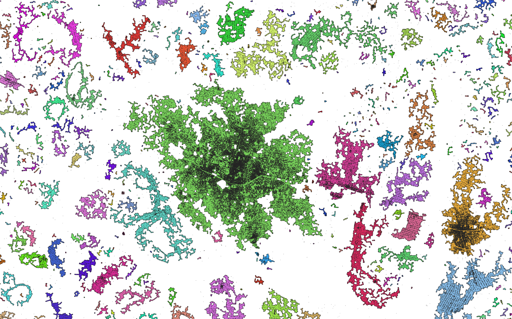

# Sympolis Workflow
The *Sympolis* Workflow clusters and visualizes urban areas from individual building footprint polygons. It is orchestrated with the [Common Workflow Language (CWL)](https://www.commonwl.org/user_guide/), with each stage being a C++ command line program wrapped with CWL. The implementation depends on the [*Fishnet*](https://github.com/DescartesResearch/fishnet) framework.

The name derives from the Ancient Greek *sympoliteia* (συμπολιτεία), from *syn* (σύν, "together") and *polis* (πόλις, "city"), the union of several city-states into a single political community. Likewise, the workflow merges individual settlements into contiguous urban areas. Sympolis was originally developed in collaboration with the [OECD/SWAC Africapolis](https://africapolis.org) team.



# Quick Start
All binaries of the workflow and the GDAL library are packaged in the
[_ghcr.io/dfg-sos/sympolis_](https://github.com/dfg-sos/sympolis/pkgs/container/sympolis) docker image, the Fishnet tools in
[_ghcr.io/descartesresearch/fishnet-apps_](https://github.com/DescartesResearch/fishnet/pkgs/container/fishnet-apps). The CWL files reference both
images, so the only requirements are docker and a [CWL Runner](https://www.commonwl.org/implementations/)
supporting containerized execution, e.g. the reference runner [cwltool](https://cwltool.readthedocs.io/en/latest/cli.html#cwltool):
```shell
python -m venv .venv
source .venv/bin/activate
python -m pip install cwltool
```
Run the workflow's main definition file ([_Sympolis.cwl_](Sympolis.cwl)) with the
[_default_](jobs/default.yml) job file, which processes the small example input
[_Kahama_Small.gpkg_](data/input/Kahama_Small.gpkg) shipped with the repository:
```shell
cwltool Sympolis.cwl jobs/default.yml
```
To process your own data, copy the job file and point its `vectorFile` (or `shapefile`) entry to
your input, see [Configuration](#configuration).

# Workflow Structure
[_Sympolis.cwl_](Sympolis.cwl) is the entry point of the workflow. It references the tools and
subworkflows in the [_cwl_](cwl) directory, each of which wraps one command line program. The stages
run in the following order, the input being processed tile by tile until the last two steps merge
the tiles back together.

| Step | Definition | Task |
|---|---|---|
| `split` | [_FishnetSplit.cwl_](cwl/FishnetSplit.cwl) | Splits the input into tiles, which the following steps process in parallel |
| `filter` | [_FishnetFilter.cwl_](cwl/FishnetFilter.cwl) | Assigns a unique *Fishnet ID* to every settlement polygon |
| `graph_generation` | [_GraphConstruction.cwl_](cwl/GraphConstruction.cwl) → [_GraphConstructionPreprocessing.cwl_](cwl/GraphConstructionPreprocessing.cwl), [_GraphConstructionTool.cwl_](cwl/GraphConstructionTool.cwl) | Pairs every tile with its neighbouring tiles and connects neighbouring settlements into a settlement graph, one graph per tile |
| `graph_components` | [_GraphComponents.cwl_](cwl/GraphComponents.cwl) → [_GraphComponentsTool.cwl_](cwl/GraphComponentsTool.cwl) | Retrieves the connected components of the settlement graph and balances them into clustering workloads |
| `clustering` | [_SpatialClustering.cwl_](cwl/SpatialClustering.cwl) → [_SpatialClusteringTool.cwl_](cwl/SpatialClusteringTool.cwl), [_MSTVisualization.cwl_](cwl/MSTVisualization.cwl) | Clusters the settlements of each workload and buffers the minimum spanning tree connecting the settlements of a cluster |
| `visualization` | [_PolygonOutline.cwl_](cwl/PolygonOutline.cwl) | Buffers, unions and erodes the settlements of a cluster into the outline of an urban area |
| `postFilter` | [_FishnetFilter.cwl_](cwl/FishnetFilter.cwl) | Drops the urban areas rejected by the post filter |
| `mergeMultiPolygons`, `mergeConcaveHulls` | [_FishnetMerge.cwl_](cwl/FishnetMerge.cwl) | Merges the tiles back into the two outputs of the workflow |

### Outputs
| Output | Info |
|---|---|
| `sympolis` | Vector file (.gpkg) holding one polygon per urban area |
| `multi_polygons` | Vector file (.gpkg) holding the clustered settlement polygons, each carrying the `ClusterID` of the urban area it belongs to |

# Configuration
The workflow is configured through its CWL parameters alone, either as command line arguments or
through a *job file*. The parameters are grouped by the step consuming them, in the order in which
the steps run. Values marked with an empty default are only passed on when set.

### Input
| Parameter | Default | Info |
|---|---|---|
| `--shapefile` | | Path to the shapefile (.shp) containing the settlement polygons |
| `--vectorFile` | | Path to the vector file (.gpkg) containing the settlement polygons |

Exactly one of the two is given, depending on the format of the input.

### Split — [_FishnetSplit.cwl_](cwl/FishnetSplit.cwl)
| Parameter | Default | Info |
|---|---|---|
| `--partitionDepth` | `1` | Depth of the quadrant splitting applied to the input, creating `4^partitionDepth` tiles which the following steps process in parallel |

### Graph Construction — [_GraphConstructionTool.cwl_](cwl/GraphConstructionTool.cwl)
| Parameter | Default | Info |
|---|---|---|
| `--graphConstructionMode` | `DELAUNAY` | `BUFFER_SWEEP` uses a sweeping buffer, connecting up to `--maxNeighborsPerNode` neighbours for each polygon within the distance threshold. `DELAUNAY` computes a delaunay triangulation upon the centroids of the settlement polygons and filters its edges according to the distance threshold |
| `--graphDistanceThreshold` | `200.0` | Maximum distance in meters between two settlements sharing an edge |
| `--maxNeighborsPerNode` | | Maximum number of edges per settlement. Required by `BUFFER_SWEEP`, ignored by `DELAUNAY` |

### Graph Components — [_GraphComponentsTool.cwl_](cwl/GraphComponentsTool.cwl)
| Parameter | Default | Info |
|---|---|---|
| `--maxComponentsPerWorkload` | `5000` | Maximum number of graph components assigned to a single clustering task |

### Clustering — [_SpatialClusteringTool.cwl_](cwl/SpatialClusteringTool.cwl)
| Parameter | Default | Info |
|---|---|---|
| `--clusteringMode` | `DBSCAN` | `BFS` retrieves the connected components of the settlement subgraph whose edges comply with the distance threshold. `DBSCAN` retrieves density-based clusters of settlements separated by less than the distance threshold, classifying settlements of clusters smaller than `--minClusterSize` as *noise*. `DBSC` adopts `DBSCAN`, applying heuristics-based trimming to the settlement graph in the `--dbscBeta`-order neighborhood of each settlement, and can combine spatial distance with attribute-based similarity |
| `--clusterDistanceThreshold` | `200.0` | Maximum distance in meters between two settlements of the same cluster |
| `--minClusterSize` | `3` | Minimum number of settlements per cluster. Required by `DBSCAN` and `DBSC` |
| `--dbscBeta` | | Order of the neighborhood considered when trimming the settlement graph. Required by `DBSC` |
| `--dbscT1` | | Custom `t1` threshold of the `DBSC` heuristic. Derived from the data when omitted |
| `--dbscAttributeMapper` | `NONE` | Settlement attribute combined with the spatial distance by `DBSC`. Only `AREA` is supported, which takes the area of the settlement polygons into account |

### MST Visualization — [_MSTVisualization.cwl_](cwl/MSTVisualization.cwl)
| Parameter | Default | Info |
|---|---|---|
| `--mstBuffer` | `30.0` | Width in meters of the buffer applied to the MST edges connecting the settlements of a cluster |

### Outline Visualization — [_PolygonOutline.cwl_](cwl/PolygonOutline.cwl)
| Parameter | Default | Info |
|---|---|---|
| `--initialBuffer` | `100.0` | Width in meters of the buffer grown around each settlement before it is eroded back to `--outlineBuffer` |
| `--outlineBuffer` | `30.0` | Width in meters of the buffer remaining around the settlements of a cluster after erosion |

### Post Filter — [_FishnetFilter.cwl_](cwl/FishnetFilter.cwl)
| Parameter | Default | Info |
|---|---|---|
| `--minArea` | | Drop resulting urban areas covering less than this area in square meters. No area filter is applied when omitted |
| `--dropContainedPolygons` | `false` | Drop resulting urban areas which are fully contained in another one |

### Diagnostics
| Parameter | Default | Info |
|---|---|---|
| `--debug` | `false` | Enable debug logging in every step of the workflow |

### Job Files
The input file has to declare its format (see below), which a file passed on the command line
(e.g. `cwltool Sympolis.cwl --vectorFile <File.gpkg>`) cannot do, so the workflow is run with a CWL job
file. A job file is also the practical way of keeping a parameter set around and reproducing a run
later. The [_jobs_](jobs) directory holds one ready to run job file per parameter set, each
processing [_Kahama_Small.gpkg_](data/input/Kahama_Small.gpkg), except for _default_shapefile.yml_, which reads the same
data from [_Kahama_Small.shp_](data/input/Kahama_Small.shp):

| Job file | Graph construction | Clustering |
|---|---|---|
| [_default.yml_](jobs/default.yml) | `DELAUNAY`, 200 m | `DBSCAN`, 200 m, min. 3 settlements, urban areas below 1000 m² dropped |
| [_default_shapefile.yml_](jobs/default_shapefile.yml) | `DELAUNAY`, 200 m | `DBSCAN`, 200 m, min. 3 settlements, urban areas below 1000 m² dropped (as _default.yml_, reading the shapefile) |
| [_bfs200_delaunay.yml_](jobs/bfs200_delaunay.yml) | `DELAUNAY`, 200 m | `BFS`, 200 m |
| [_bfs200_sweep.yml_](jobs/bfs200_sweep.yml) | `BUFFER_SWEEP`, 200 m, 5 neighbours | `BFS`, 200 m |
| [_dbscan200_delaunay.yml_](jobs/dbscan200_delaunay.yml) | `DELAUNAY`, 200 m | `DBSCAN`, 200 m, min. 3 settlements |
| [_dbscan200_sweep.yml_](jobs/dbscan200_sweep.yml) | `BUFFER_SWEEP`, 200 m, 5 neighbours | `DBSCAN`, 200 m, min. 5 settlements |
| [_dbsc200_sweep.yml_](jobs/dbsc200_sweep.yml) | `BUFFER_SWEEP`, 200 m, 5 neighbours | `DBSC`, 200 m, min. 5 settlements, beta 2 |
| [_dbsc200_area._sweep.yml_](jobs/dbsc200_area._sweep.yml) | `BUFFER_SWEEP`, 200 m, 5 neighbours | `DBSC`, 200 m, min. 5 settlements, beta 2, `AREA` attribute |

[_default.yml_](jobs/default.yml), for example, reads:
```yaml
# --- Input data ---
vectorFile:
  class: File
  path: ../data/input/Kahama_Small.gpkg  # replace with your own input file path
  format: "https://dfg-sos.github.io/ontologies/eo-formats#GeoPackage"
# --- Parameters ---
# Delaunay graph construction with DBSCAN clustering at 200m, dropping urban areas below 1000 m².
partitionDepth: 1
graphConstructionMode: DELAUNAY
graphDistanceThreshold: 200.0
clusteringMode: DBSCAN
clusterDistanceThreshold: 200.0
minClusterSize: 3
minArea: 1000.0
```
The `format` entry states the format of the input file as a term of the
[SOS Earth Observation file formats](https://dfg-sos.github.io/ontologies/) vocabulary:
`eo-formats#GeoPackage` for a `vectorFile`, `eo-formats#Shapefile` for a `shapefile`. The CWL
runner rejects input files declaring no or a different format.
Paths in a job file are resolved relative to the job file itself. A job file describes a run
completely, so command line arguments cannot be added on top of it. Copy one of the job files and
adapt its `vectorFile` (or `shapefile`) entry to run a parameter set on your own data.

# HPC Deployment
Use the [Sympolis Shellscript](prod/hpc/run-sympolis.sh) to install and run the workflow on a HPC system. You can also do the following steps manually:
### 1. Upload Files
- Upload `Sympolis.cwl`, the `cwl` directory holding the tools it references and the `jobs` directory holding the parameter presets, keeping the directory structure of the repository
- Upload input files or pull from STAC
### 2. Install Toil
- Create python venv
```
module load python
python -m venv ~/sympolis-workflow/venv
```
- Source venv
``` 
source ~/sympolis-workflow/venv/bin/activate
```
- Install via pip
```
pip install toil[cwl]
```
### 3. Execute Workflow
Execute via the `toil-cwl-runner` directly (current directory will be output directory), passing a
job file which sets the input and the parameters of the run
```
module load apptainer
source ~/sympolis-workflow/venv/bin/activate
toil-cwl-runner --singularity --batchSystem slurm ~/sympolis-workflow/Sympolis.cwl <Job.yml>
```
The [shellscript](prod/hpc/run-sympolis.sh) does this for you, taking the input file and a
preset holding everything else, the partition depth included. Without `--preset`,
[_default.yml_](jobs/default.yml) is used.
```
./run-sympolis.sh --preset ~/sympolis-workflow/jobs/dbsc200_sweep.yml <File.gpkg>
```
Alternatively, pass a complete job file with `--job`, which is run as is, its input included. Its
relative paths are resolved against the location of the job file.
```
./run-sympolis.sh --job <Job.yml>
```
The outputs are written to `~/sympolis-workflow/output/<Experiment>`, named after the input file
and the preset (`<File>_<Preset>`), or after the job file when using `--job`.

# Development
### Binaries (C++)
The required binaries of *Sympolis* can be manually install on the system. This can be achieved with the [install](install.sh) script. Make sure that the install prefix location (*$INSTALL_PREFIX*) is referenced in *PATH* (e.g. *usr/local/bin*). 
```shell
./install.sh
```
Each binary is configured through its own command line options and takes no configuration file.
Run a binary with `--help` to list them, for instance:
```
SympolisSpatialClustering --mode DBSC --distance-threshold 200 --min-cluster-size 5 --beta 2 -i <File.gpkg> -g <Graph.bin> --outputStem <Stem>
```
| Binary | Wrapped by |
|---|---|
| `SympolisGraphConstruction` | [_GraphConstructionTool.cwl_](cwl/GraphConstructionTool.cwl) |
| `SympolisGraphComponents` | [_GraphComponentsTool.cwl_](cwl/GraphComponentsTool.cwl) |
| `SympolisSpatialClustering` | [_SpatialClusteringTool.cwl_](cwl/SpatialClusteringTool.cwl) |
| `SympolisMSTVisualization` | [_MSTVisualization.cwl_](cwl/MSTVisualization.cwl) |
| `SympolisPolygonOutline` | [_PolygonOutline.cwl_](cwl/PolygonOutline.cwl) |
| `SympolisEdgeVisualization` | [_EdgeVisualization.cwl_](cwl/EdgeVisualization.cwl) |

### Docker Image
The [Dockerfile](Dockerfile) builds the binaries on top of `ghcr.io/descartesresearch/fishnet-deps` and copies them into
a GDAL runtime image. Since the CWL files reference `ghcr.io/dfg-sos/sympolis:latest`, a locally built image
is picked up by `cwltool` instead of the published one:
```shell
docker build -t ghcr.io/dfg-sos/sympolis:latest .
cwltool Sympolis.cwl jobs/default.yml
```
The image is published by the CI pipeline.

### CI/CD
The [CI workflow](.github/workflows/ci.yml) runs on pushes and pull requests to `main` that touch
the binaries, the image or the workflow tested by it (`src`, `lib`, `CMakeLists.txt`, `Dockerfile`,
`Sympolis.cwl`, `cwl`, `jobs/default.yml` and the pipeline itself). Changes to
the documentation, the other job files or the HPC scripts do not trigger it.
1. Builds the binaries by building the [Dockerfile](Dockerfile) (`ghcr.io/dfg-sos/sympolis:latest` and `ghcr.io/dfg-sos/sympolis:<version>`, the version taken from [CMakeLists.txt](CMakeLists.txt))
2. Runs every binary with `--help` as a smoke test
3. Validates [Sympolis.cwl](Sympolis.cwl) and executes it with [jobs/default.yml](jobs/default.yml) using `cwltool`, against the freshly built image. The outputs are uploaded as the `sympolis-output` artifact.
4. On pushes to `main` only, publishes both image tags to the GitHub Container Registry.

Publishing authenticates with the workflow's `GITHUB_TOKEN`, so no secrets are needed.
